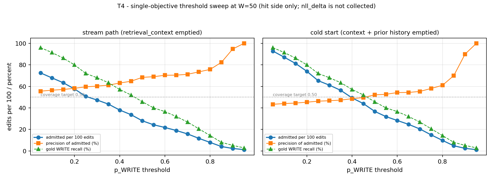

# Learned gate: ranking vs distribution shift (T3) and threshold sweep (T4)

Generated by `analysis_gate_roc_pr.py` on the 835-record CounterFact test split. All columns use the same trained classifier and the same records; they differ only in which signals are emptied, so the gap between them isolates the distribution shift from the ranking.

- **offline** — the split as labelled (context and side memory populated).
- **stream simulation** — `retrieval_context` emptied for every record, because `CALMEditor.edit_requests` calls `gate.decide(..., retrieval_context=None)` (`EasyEdit/easyeditor/editors/calm_editor.py:203`).
- **cold start** — `retrieval_context` *and* `prior_edits` emptied, which is the state of the gate before the first edit of a stream.

| quantity | offline | stream simulation | cold start |
|---|---|---|---|
| AUC, WRITE vs rest | 0.9662 | 0.772 | 0.6025 |
| AP, WRITE | 0.9537 | 0.6732 | 0.5377 |
| TPR @ p>=0.5 | 0.7229 | 0.4571 | 0.4571 |
| realised write share (argmax) | 0.3102 | 0.2802 | 0.3677 |
| admitted per 100 edits | 31.0 | 28.0 | 36.8 |
| precision of admitted (gold WRITE) | 0.9768 | 0.6838 | 0.5212 |

### Confusion matrices (rows = gold, columns = WRITE / ROUTE / REJECT)

**offline**

| gold \ pred | WRITE | ROUTE | REJECT |
|---|---|---|---|
| WRITE | 253 | 0 | 97 |
| ROUTE | 0 | 360 | 0 |
| REJECT | 6 | 0 | 119 |

**stream simulation**

| gold \ pred | WRITE | ROUTE | REJECT |
|---|---|---|---|
| WRITE | 160 | 0 | 190 |
| ROUTE | 73 | 180 | 107 |
| REJECT | 1 | 0 | 124 |

**cold start**

| gold \ pred | WRITE | ROUTE | REJECT |
|---|---|---|---|
| WRITE | 160 | 0 | 190 |
| ROUTE | 146 | 0 | 214 |
| REJECT | 1 | 0 | 124 |

### Threshold sweep on the stream simulation

| p_WRITE threshold | admitted per 100 | precision (gold WRITE) | gold WRITE recall |
|---|---|---|---|
| 0.05 | 72.5 | 0.5554 | 0.96 |
| 0.10 | 67.9 | 0.5644 | 0.9143 |
| 0.15 | 63.4 | 0.5709 | 0.8629 |
| 0.20 | 57.6 | 0.5821 | 0.8 |
| 0.25 | 50.7 | 0.5957 | 0.72 |
| 0.30 | 47.3 | 0.6025 | 0.68 |
| 0.35 | 43.5 | 0.6116 | 0.6343 |
| 0.40 | 38.0 | 0.6309 | 0.5714 |
| 0.45 | 33.7 | 0.6477 | 0.52 |
| 0.50 | 28.0 | 0.6838 | 0.4571 |
| 0.55 | 24.3 | 0.6897 | 0.4 |
| 0.60 | 21.8 | 0.7033 | 0.3657 |
| 0.65 | 19.0 | 0.7044 | 0.32 |
| 0.70 | 15.8 | 0.7121 | 0.2686 |
| 0.75 | 11.7 | 0.7347 | 0.2057 |
| 0.80 | 7.9 | 0.7576 | 0.1429 |
| 0.85 | 4.1 | 0.8235 | 0.08 |
| 0.90 | 2.3 | 0.9474 | 0.0514 |
| 0.95 | 1.2 | 1.0 | 0.0286 |

### Threshold sweep on the cold start

| p_WRITE threshold | admitted per 100 | precision (gold WRITE) | gold WRITE recall |
|---|---|---|---|
| 0.05 | 92.8 | 0.4335 | 0.96 |
| 0.10 | 87.1 | 0.4402 | 0.9143 |
| 0.15 | 81.3 | 0.4448 | 0.8629 |
| 0.20 | 74.0 | 0.4531 | 0.8 |
| 0.25 | 65.3 | 0.4624 | 0.72 |
| 0.30 | 61.1 | 0.4667 | 0.68 |
| 0.35 | 56.3 | 0.4723 | 0.6343 |
| 0.40 | 49.3 | 0.4854 | 0.5714 |
| 0.45 | 44.0 | 0.4959 | 0.52 |
| 0.50 | 36.8 | 0.5212 | 0.4571 |
| 0.55 | 31.9 | 0.5263 | 0.4 |
| 0.60 | 28.3 | 0.5424 | 0.3657 |
| 0.65 | 24.7 | 0.5437 | 0.32 |
| 0.70 | 20.4 | 0.5529 | 0.2686 |
| 0.75 | 14.9 | 0.5806 | 0.2057 |
| 0.80 | 9.8 | 0.6098 | 0.1429 |
| 0.85 | 4.8 | 0.7 | 0.08 |
| 0.90 | 2.4 | 0.9 | 0.0514 |
| 0.95 | 1.2 | 1.0 | 0.0286 |

### Control: what the 191-edit stream actually admitted

| arm | admitted / 100 | gold WRITE | model hit | E2E hit | model hit per write |
|---|---|---|---|---|---|
| `always_write` | 100.0 | 76 | 21 | 21 | 0.1099 |
| `always_route` | 0.0 | 76 | 21 | 191 | None |
| `rule_gate` | 18.8 | 76 | 21 | 191 | 0.5833 |
| `learned_gate` | 0.5 | 76 | 21 | 191 | 21.0 |

**Missing half of the double objective.** `nll_delta` is not recorded by `run_w4_gate_ablation.py`, so no row above pairs a hit count with a fluency delta. Treat every admission number here as coverage-only evidence, not as a pass on the (hit, NLL) criterion.

