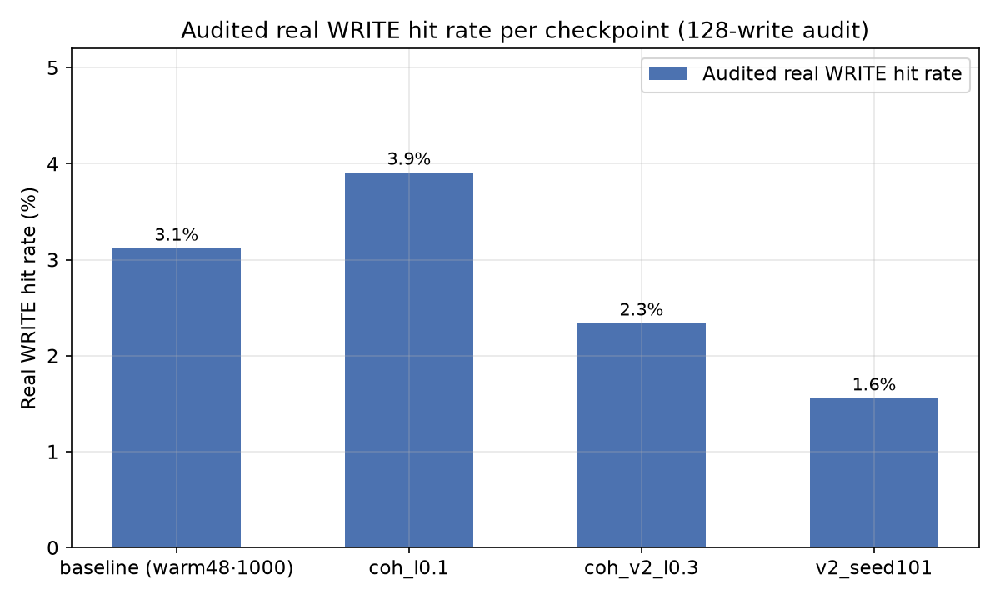
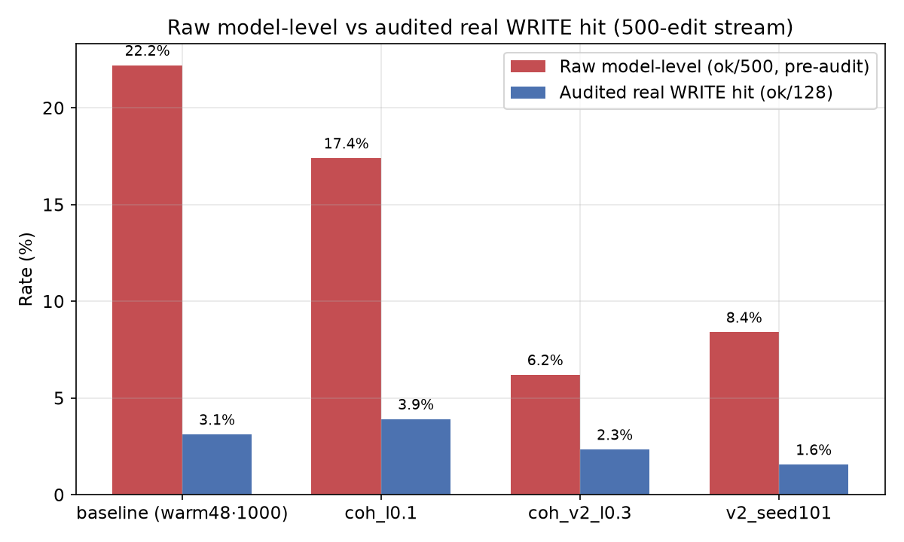

---
AIGC:
    Label: "1"
    ContentProducer: 001191440300708461136T1XGW3
    ProduceID: 8aaebaa239fa14c1cf5eb03fd99189ca_cc609412d79611f1a216525400248c00
    ReservedCode1: cy3f46rs3HCXIPdgn+ckMR1r8FiBuAKT2uwzSIsRUpvG8wNUuqfbpDOoAicC0+vEAvcCU6ZyJJBh32zjQfE1C6covFho9B8MstZvjnegx5Zh9Yy2PJJkzbsVFmlbsIAm5vza9thMJP19y6q4oeNNjpovMxM7A1lSzeazOxk4gKITokOrSf3EgJ6xxiU=
    ContentPropagator: 001191440300708461136T1XGW3
    PropagateID: 8aaebaa239fa14c1cf5eb03fd99189ca_cc609412d79611f1a216525400248c00
    ReservedCode2: cy3f46rs3HCXIPdgn+ckMR1r8FiBuAKT2uwzSIsRUpvG8wNUuqfbpDOoAicC0+vEAvcCU6ZyJJBh32zjQfE1C6covFho9B8MstZvjnegx5Zh9Yy2PJJkzbsVFmlbsIAm5vza9thMJP19y6q4oeNNjpovMxM7A1lSzeazOxk4gKITokOrSf3EgJ6xxiU=
---

# Main Results Summary (W2–W4, with W5 audit correction)

> Compiled 2026-11-03 for the W4→W5 handover.
> All numbers come from the repository artifacts listed in [Data sources](#data-sources).
> The W5 per-edit audit corrects the previously reported W4 model-level WRITE-hit numbers; the raw (pre-audit) figures are kept for transparency and marked as such.

## 1. W2 — Single-fact editing baselines (gpt2-xl, n=50)

Same evaluation protocol (`docs/evaluation_protocol.md`): reliability (`rewrite_acc`), generalisation (`rephrase_acc`), locality (`neighborhood_acc` on CounterFact / `nq_acc` on zsRE), portability (`p1_acc` on MQuAKE).

| Method | Dataset | Reliability | Generalisation | Locality | Portability |
|---|---|---|---|---|---|
| ROME (parametric) | CounterFact | 1.000 | 0.700 | 0.842 | — |
| ROME (parametric) | zsRE | 0.997 | 0.807 | 0.966 | — |
| ROME (parametric) | MQuAKE | 0.947 | — | — | 0.069 |
| IKE (memory-based) | CounterFact | 1.000 | 0.720 | 0.188 | — |
| IKE (memory-based) | zsRE | 0.993 | 0.985 | 0.670 | — |
| GRACE (memory-based) | CounterFact | 1.000 | 0.000 | 1.000 | — |
| GRACE (memory-based) | zsRE | 1.000 | 0.000 | 1.000 | — |

Notes:
- ROME GPT-J-6B smoke (zsRE n=10, Colab T4 16GB): rewrite 1.000 / rephrase 0.950 / nq 0.610; full 6B evaluation is infeasible on the local 8GB RTX 4070.
- GRACE rephrase 0.000 is a method property (keyed on the last prompt token), not a bug.

## 2. W3/W4 — CALM sequential editing streams (gpt2-small, CounterFact)

| Stream | Variant | WRITE | ROUTE | REJECT | e2e immediate | model-level immediate | retention |
|---|---|---|---|---|---|---|---|
| W3 1K | trained hypernet | ~85.5% | ~14.1% | ~0.4% | 17.2% | 0.4% | 0/9 |
| W3 1K | baseline (no hypernet) | ~85.1% | ~14.1% | ~0.8% | 15.1% | 1.0% | 0/9 |
| W4 5K | trained hypernet | 85.2% | 14.7% | 0.1% | 14.78% | 0.08% | 0/9 |
| W4 5K | baseline (no hypernet) | 85.6% | 14.2% | 0.2% | 14.86% | 0.76% | 0/9 |
| W4 5K | **+ write_budget=128, dual-write (fix)** | 2.56% (128) | 97.4% (4870) | 2 | **97.48%** | 0.08% | **9/9** |

Key findings:
- Scaling 1K→5K degrades end-to-end immediate rewrite for both configs (trained 17.2%→14.78%, baseline 15.1%→14.86%); at 5K the meta-trained hypernetwork no longer beats the baseline.
- The bounded-write fix makes the *system-level* lifelong stream succeed: 97.48% end-to-end rewrite, 9/9 memory-backed retention.

## 3. W4 — Model-level write-quality improvement (500-edit stream, write_budget=128, dual-write)

### 3.1 Training-configuration sweep (raw, pre-audit)

| Training configuration | Model-level immediate | WRITE hit rate | Audited real WRITE hit (128-write audit) |
|---|---|---|---|
| W3 old ckpt (single-edit) | 4/500 (0.8%) | 3.1% | un-audited |
| accum, segment_len=4 | 8/500 (1.6%) | 6.3% | un-audited |
| accum, segment_len=16 | 51/500 (10.2%) | 39.8% | un-audited |
| accum16 + gate-distribution sampling | 32/500 (6.4%) | 25.0% | un-audited |
| accum, segment_len=32 | 37/500 (7.4%) | 28.9% | un-audited |
| accum16 + warm-start 32 | 56/500 (11.2%) | 43.8% | un-audited |
| accum16 + warm-start 48 (best) | 85/500 (17.0%) | 66.4% | un-audited |
| accum16 + warm-start 64 | 35/500 (7.0%) | 27.3% | un-audited |
| **accum16 + warm-start 48, 1000 steps** | **111/500 (22.2%)** | **86.7%** | **4/128 (3.1%)** |

### 3.2 W5 per-edit audit (128-write audit on real stream WRITEs)

| Checkpoint | Raw model-level ok | WRITE.rewrite_ok | Real WRITE hit rate | REJECT.rewrite_ok | ROUTE.rewrite_ok | Audit JSON |
|---|---|---|---|---|---|---|
| baseline (accum16+warm48·1000) | 111 | 4 | **3.1% (4/128)** | 107 | 0 | `w4_model_level_improve/results/audit_baseline.json` |
| coh_l0.1_c0.6 | 87 | 5 | **3.9% (5/128)** | 82 | 0 | `w4_model_level_improve/results/audit_coh_l0.1.json` |
| coh_v2_l0.3_c0.6 | 31 | 3 | **2.3% (3/128)** | 28 | 0 | `w4_model_level_improve/results/audit_coh_v2_l0.3_c0.6.json` |
| v2_seed101 | 42 | 2 | **1.6% (2/128)** | 40 | 0 | `w4_model_level_improve/results/audit_v2_seed101.json` |

Audit conclusion:
- The pre-audit "WRITE hit rate" (`model_level_ok/128`) counts every gate-level success, including REJECTed edits where the model already answers correctly. For the best checkpoint, 107 of the 111 raw hits are REJECT false hits and ROUTE contributes 0; the genuine parameter-write hit rate is only **4/128 (3.1%)**, i.e. 124/128 real WRITEs still miss.
- The audited improvement is therefore **0.08% → 3.1%** on real WRITEs (not 0.08% → 22.2%).
- Coherence-penalty and multi-seed routes do not exceed the baseline's real write quality (5/128, 3/128, 2/128 vs 4/128); all are dominated by REJECT false hits.

## 4. Bottom line

- **System level:** the bounded-write + dual-write fix solves lifelong retention end-to-end (97.48% rewrite, 9/9 retention on 5K CounterFact).
- **Model level:** the earlier 22.2% / 86.7% claims were inflated by REJECT false hits; real parameter-WRITE quality is ~1.6–3.9% across audited checkpoints. Improving it remains an open problem (further warm-started training, lr decay, longer steps).

## Data sources

- `docs/w2_rome_reproduction.md`, `docs/w2_ike_grace_reproduction.md` (W2 baselines)
- `output/w3_calm_stream_1k.json`, `output/w4_sequential_5k_results.json`, `output/w4_calm_fix_5k_results.json` (W3/W4 streams)
- `w4_model_level_improve/results/audit_*.json` (W5 audit)
- `README.md` "W4 — Model-level write quality improvement"
*（内容由AI生成，仅供参考）*
